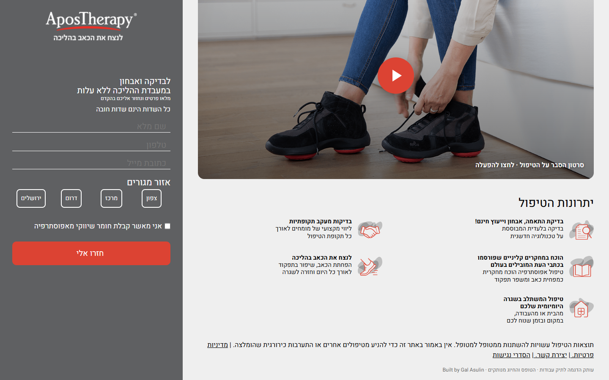
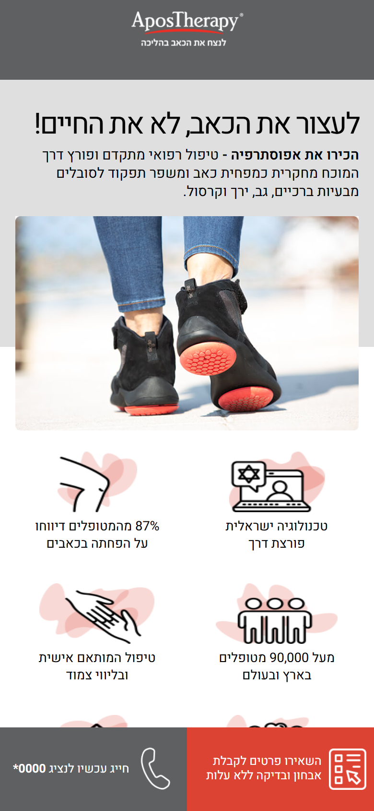
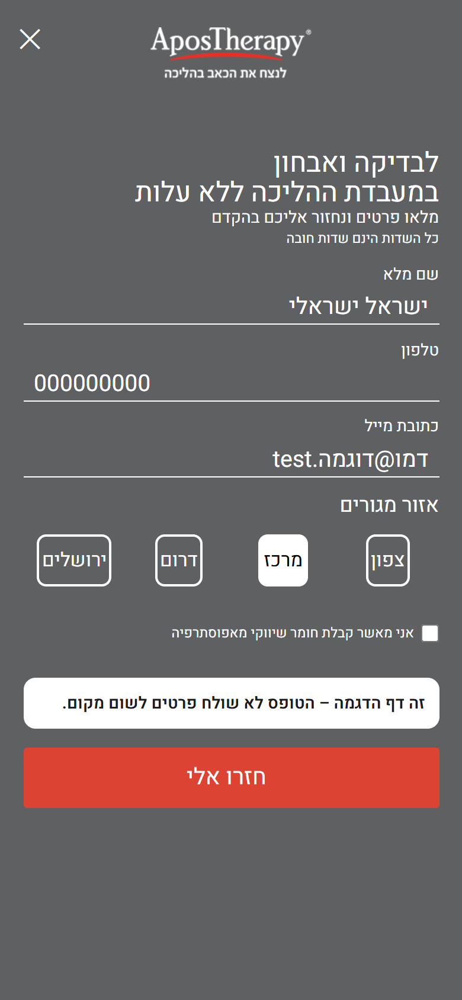

### AposTherapy · the original lead-generation landing page

*Always-visible lead form · mobile action bar · fluid viewport-scaled design · validation + honeypot · Hebrew RTL*

 

**[▶ Open the live demo](https://galasulin.github.io/apostherapy-lead-landing/)**

🇮🇱 [**גרסה עברית מלאה**](README.he.md)

> **Showcase repository.** This is a sanitized, static copy of a landing page that runs in production on the company's domain. The tag manager, the CRM lead endpoint, the third-party accessibility widget and every real phone number were removed. The form still validates, but it never sends anything: a valid submit only shows a demo notice. See [Privacy / what was removed](#-privacy--what-was-removed).

---

## 📖 What it is

The paid-traffic landing page for AposTherapy, a non-surgical treatment for knee, back, hip and ankle pain. Its one job is to turn an ad click into a booked free gait-lab check, so everything on it serves that: a promise headline, seven proof points, the health-fund logos, a video, the treatment's advantages and, always within reach, a short form.

It is the first page of a series. The [research-led page](https://github.com/galasulin/apostherapy-research-landing) and the [Apos 4 scroll story](https://github.com/galasulin/apos4-scroll-landing) came later and reuse its form fields and lead pipeline.

## ✨ What is special about it

| | |
|---|---|
| **The form never leaves the screen** | On desktop the page is a two-column layout: the content scrolls, while the lead form sits in a full-height `position: sticky` column. A visitor can convert at any scroll depth without hunting for a button. |
| **A mobile action bar** | On phones the form becomes a full-screen overlay, opened from a fixed bottom bar with two actions: *leave details* and *call now*. In production the call button appeared only during call-centre hours (Sun–Thu 08:00–18:00, Fri 08:00–13:00). |
| **Call tracking by traffic source** | In production, the PHP page picked the phone number shown to the visitor from the ad source in the URL, so every call could be attributed to its campaign, and one source could hide the call option entirely. (Removed in this copy.) |
| **Fluid, design-faithful scaling** | Sizes are set in `vw`, so the desktop layout scales proportionally with the window and keeps the designer's composition at any width; a separate mobile layout reorders the proof points with `order`. |
| **A careful form** | Floating labels done in pure CSS (`:placeholder-shown`), pill-style region radios, a marketing-consent checkbox, full-name / phone / email validation with inline warnings, and a hidden **honeypot** field that quietly drops bot submissions. |
| **Lead delivery that admits failure** | In production the submit posted to the CRM with UTM passthrough, retried once on a network blip, re-enabled the button and showed a friendly error if it still failed, and pushed a *failed* event to the tag manager so a broken endpoint shows up in reports instead of looking like a quiet day. |
| **Accessibility pass** | Skip link, visible focus rings, `role="radiogroup"`, `aria-live` warnings, 44 px touch targets, AA-contrast error colour, a `noscript` fallback, and `prefers-reduced-motion`. |
| **Performance + SEO** | Every image has explicit dimensions and lazy-loads below the fold, the logo loads with `fetchpriority="high"`, and the production page carried a JSON-LD graph plus Open Graph / Twitter cards. |

## 🖥️ Screenshots

<table>
  <tr>
    <td width="50%"> <b>Desktop, scrolled</b> · the content moves, the form stays.</td>
    <td width="25%"> <b>Mobile</b> · proof points and the bottom action bar.</td>
    <td width="25%"> <b>Mobile form (demo)</b> · a valid submit only shows the demo notice.</td>
  </tr>
</table>

## 🛠️ Stack

- **HTML5 + CSS3** (flex/grid, `position: sticky`, viewport units, pure-CSS floating labels) with **Heebo** from Google Fonts.
- **Vanilla JavaScript** in this copy (`demo-form.js`). Production used jQuery for the lead script.
- In production: a PHP page with a server-side tracking-number map, a tag manager and a CRM lead endpoint (all removed here).

## 👤 My role

I designed and built this page: the layout and its desktop/mobile behaviour, the form and its validation, the lead delivery to the CRM with source attribution and failure reporting, the call-tracking logic, and the later accessibility and performance pass.

## 📌 Status

**Live in production on the company domain.** This repo is a sanitized portfolio copy: tracking removed, form disconnected, phone numbers replaced with a fake `*0000` that only shows a demo notice. It is marked `noindex` so it never competes with the live page in search.

## 🔒 Privacy / what was removed

| Removed / replaced | How |
|---|---|
| Tag manager container + `noscript` iframe, all `dataLayer` events | Removed |
| CRM lead endpoint, form keys, UTM / source passthrough, the partner second submission (`script.js`) | Replaced by `demo-form.js`: same validation, no network request |
| jQuery from a public CDN | Removed (the demo script is vanilla JS) |
| Server-side phone map (tracking numbers per ad source) and the call-hours logic | Removed; the call button is a fake, non-dialable `*0000` (no `tel:` link) that shows a demo notice |
| Star number and WhatsApp link in the `noscript` fallback and the error message | Replaced with the demo notice |
| Third-party accessibility widget (with its site key) | Removed |
| Accessibility statement with staff contact details and branch information | Not copied; replaced by `accessibility.html` without personal details |
| Embedded YouTube player | Replaced by a click-to-load poster; nothing is requested from YouTube until you press play |
| Structured data with the company phone | Removed |
| Canonical / Open Graph URLs | Pointed at this GitHub Pages copy; page marked `noindex` |
| Outbound links to the company site (privacy, contact) | Disabled; they show a demo notice |
| A commented-out old promotion block and its CSS/image, `robots.txt`, `sitemap.xml`, `404.html`, server config, old screenshots, the PDF | Not copied |
| Image metadata (EXIF / XMP / text chunks) | Stripped from every image |

The only external hosts the page loads are **Google Fonts** (`fonts.googleapis.com`, `fonts.gstatic.com`).

## 📂 In this repository

| Path | What |
|---|---|
| [`index.html`](index.html) | The page |
| [`style.css`](style.css) | Layout, form styling, mobile layout, accessibility rules, demo additions |
| [`demo-form.js`](demo-form.js) | Form overlay, validation, demo notice, click-to-load video |
| [`accessibility.html`](accessibility.html) | Short demo accessibility page |
| [`images/`](images) · [`assets/`](assets) | Page images · README screenshots |

---

**Built by [Gal Asulin](https://github.com/galasulin), IT Manager**

More landing pages: <a href="https://github.com/galasulin/apostherapy-research-landing">apostherapy-research-landing</a> · <a href="https://github.com/galasulin/apos4-scroll-landing">apos4-scroll-landing</a> · <a href="https://github.com/galasulin/apostherapy-case-study">apostherapy-case-study</a> 
© 2026 Gal Asulin · view-only portfolio, see <a href="LICENSE">LICENSE</a>

